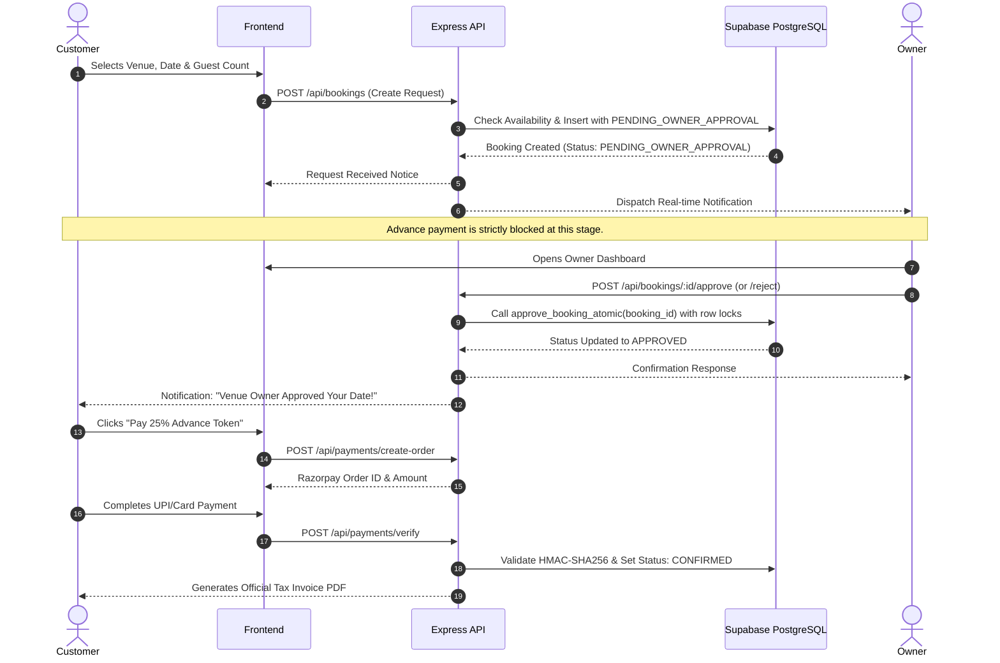

# HALL KHOJ FINDER 🏰✨

> **"Find Your Perfect Wedding Destination."**  
> *India's Premier 3D Wedding & Event Venue Marketplace*

[](https://nodejs.org/)
[](https://supabase.com/)
[](#-technology-stack)
[](https://threejs.org/)
[](https://razorpay.com/)
[](docs/TESTING_GUIDE.md)

---

## 🌟 Executive Overview

**Hall Khoj Finder** is an enterprise-grade full-stack event marketplace platform designed for India's wedding, banquet, and celebration ecosystem. The platform connects customers directly with verified marriage halls, luxury palaces, wedding cars, tent houses, caterers, and decorators.

### Key Architectural Pillars:
1. **Cinematic Royal Wedding Theme**: Midnight Navy (`#071426`), Deep Royal Blue (`#123B68`), Electric Blue (`#398BFF`), Soft Champagne (`#D9C7A0`), and Glass White (`rgba(255,255,255,0.10)`).
2. **Cinematic Multi-Video Hero**: Double-buffered video player cycling through royal Indian wedding clips with smooth crossfading, play/pause controls, and mobile fallback.
3. **Mandatory Manual Booking Approval**: Core business rule enforced server-side. Automatic booking confirmation is strictly prohibited. Requests require explicit owner approval before advance payments can be processed.
4. **Three.js 3D Venue Walkthrough**: Interactive WebGL visualizer with OrbitControls, elevated mandap stage, crystal chandeliers, banquet seating, and Daylight / Sunset / Night Gala lighting presets.
5. **Supabase PostgreSQL & RLS**: 22 normalized relational tables, zero-trust Row Level Security, transactional functions (`approve_booking_atomic`), 6 media storage buckets, and real-time alert streams.
6. **Zero-Flash Theme Engine**: Instantaneous dark/light theme switching with `localStorage` persistence and zero page flashing.
7. **Complete 22+ Customer Pages**: Comprehensive customer, owner, and superadmin workflows.

---

## 🛠️ Technology Stack

| Layer | Technologies |
|---|---|
| **Frontend** | HTML5 Semantic, CSS3 Custom Properties (Glassmorphism), Vanilla JavaScript ES6+, Leaflet Maps |
| **3D & WebGL** | Three.js (r128), OrbitControls, Canvas2D texture generator, dynamic PBR lighting |
| **Backend** | Node.js, Express 5 REST API, JWT Authentication, Multer |
| **Database** | Supabase Cloud PostgreSQL, 22 Relational Tables, RLS Policies, Stored Procedures |
| **Storage** | Supabase Storage (6 Buckets: covers, gallery, videos, avatars, KYC, invoices) |
| **Payments** | Razorpay (25% Advance Token Calculation, HMAC-SHA256 signature verification, PDF Invoices) |
| **DevOps & CI/CD** | Git, GitHub Actions, Vercel (`vercel.json`), Netlify (`netlify.toml`) |

---

## 🧭 Page Architecture (22 Customer Pages + Portals)

### Customer Website
1. **Homepage** (`frontend/index.html`): Cinematic video hero, 8-parameter advanced search bar, featured venues, 3D teaser.
2. **Explore Venues** (`frontend/search.html`): Filter by State, District, City, PIN, Category, Budget, Guest Count.
3. **Venue Details** (`frontend/hall-details.html`): Pricing, capacity, facilities, availability calendar, customer reviews.
4. **Venue Gallery** (`frontend/gallery.html`): Filterable high-definition photography with interactive modal lightbox.
5. **3D Venue Preview** (`frontend/3d-preview.html`): Dedicated full-screen Three.js walkthrough with OrbitControls and lighting controls.
6. **Compare Venues** (`frontend/compare.html`): Side-by-side comparison matrix for up to 3 venues.
7. **Favorites** (`frontend/favorites.html`): Shortlisted venues with live status badges.
8. **Booking Request** (`frontend/booking.html`): Event date reservation enforcing `PENDING_OWNER_APPROVAL`.
9. **Customer Login** (`frontend/login.html`): Phone/Email authentication with role-based redirection.
10. **Registration** (`frontend/register.html`): Customer and Venue Owner onboarding.
11. **Forgot Password** (`frontend/forgot-password.html`): Multi-step password reset workflow.
12. **Customer Profile** (`frontend/profile.html`): Avatar upload, contact details, security settings.
13. **My Bookings** (`frontend/my-bookings.html`): Booking ledger with status filters and invoice downloads.
14. **Payment History** (`frontend/payment-history.html`): Transaction receipts and payment details.
15. **Notifications** (`frontend/notifications.html`): Real-time alert feed with mark-as-read actions.
16. **Reviews** (`frontend/reviews.html`): Customer reviews, ratings, and owner responses.
17. **Contact Us** (`frontend/contact.html`): Concierge assistance and inquiry submission form.
18. **About Us** (`frontend/about.html`): Platform story, core pillars, and national coverage.
19. **Help Center** (`frontend/help.html`): Searchable accordion FAQ.
20. **Privacy Policy** (`frontend/privacy.html`): Data privacy and protection policy.
21. **Terms & Conditions** (`frontend/terms.html`): Platform terms, booking policies, and cancellation rules.

### Role-Based Dashboards
- **Customer Dashboard** (`frontend/dashboard.html`): Booking overview, advance payment modal, invoices.
- **Owner Dashboard** (`frontend/owner/dashboard.html`): Multi-venue editor, availability calendar, pending booking approval/rejection.
- **Admin Dashboard** (`frontend/admin/dashboard.html`): Superadmin telemetry, KYC venue verification, dispute resolution.

---

## 🔒 Mandatory Manual Booking Workflow (Phase 9)



---

## ⚡ Quickstart & Local Development

### 1. Prerequisites
- Node.js v18+ (tested on v20 and v24)
- npm v9+

### 2. Installation
```bash
# Clone the repository
git clone https://github.com/your-username/hall-khoj-finder.git
cd hall-khoj-finder

# Install dependencies
npm install
```

### 3. Environment Setup
Copy the example environment file:
```bash
cp .env.example .env
```
Fill in your Supabase, Razorpay, or MongoDB credentials. If left unconfigured, the platform automatically boots using the resilient local transactional JSON database.

### 4. Running the Automated Test Suite
```bash
npm test
```
Executes all 10 verification test suites in `scratch/test_suite.js`.

### 5. Running the Application
```bash
# Start the local Express server
npm start

# Access the application in your browser:
# http://localhost:3000
```

---

## 📚 Complete Documentation Suite

All system documentation is organized in `/docs/`:

| Document | Purpose |
|---|---|
| [`PROJECT_AUDIT.md`](docs/PROJECT_AUDIT.md) | Initial forensic codebase audit |
| [`SYSTEM_ARCHITECTURE.md`](docs/SYSTEM_ARCHITECTURE.md) | Platform topology, layers, and data flow |
| [`DATABASE_SCHEMA.md`](docs/DATABASE_SCHEMA.md) | 22 Supabase PostgreSQL table definitions |
| [`DATABASE_RELATIONSHIPS.md`](docs/DATABASE_RELATIONSHIPS.md) | Relational constraints and ER diagram |
| [`RLS_SECURITY_POLICIES.md`](docs/RLS_SECURITY_POLICIES.md) | Granular Row Level Security policies |
| [`BOOKING_WORKFLOW.md`](docs/BOOKING_WORKFLOW.md) | Sequence diagram and approval business logic |
| [`PAYMENT_INTEGRATION.md`](docs/PAYMENT_INTEGRATION.md) | Razorpay HMAC verification and invoice generation |
| [`SUPABASE_SETUP.md`](docs/SUPABASE_SETUP.md) | Step-by-step Supabase migration instructions |
| [`DEPLOYMENT_GUIDE.md`](docs/DEPLOYMENT_GUIDE.md) | Vercel, Netlify, and Docker deployment guides |
| [`FINAL_PROJECT_REPORT.md`](docs/FINAL_PROJECT_REPORT.md) | Comprehensive sign-off and verification report |

---

## 📜 License
Licensed under the ISC License. Copyright 2026 Hall Khoj Finder Team.
