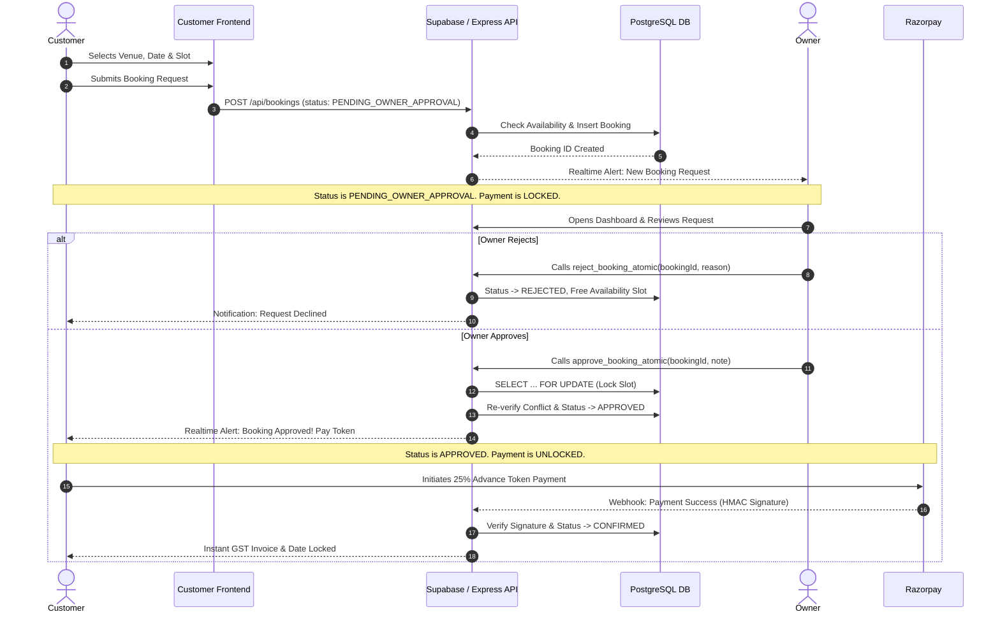

# Hall Khoj Finder — Mandatory Manual Booking Workflow (Phase 9)

## 1. Overview & Critical Business Rule
**AUTOMATIC CONFIRMATION IS STRICTLY PROHIBITED.**

Every booking request submitted on Hall Khoj Finder represents a legal intent to hire a venue or service. Because Indian weddings involve complex logistical, seasonal, and ceremonial variables, all reservations require **explicit owner approval** before any payment can be collected.

## 2. Double-Booking Prevention Guarantees
1. `SELECT ... FOR UPDATE` row locks are acquired during approval.
2. The availability slot is marked `PENDING` upon approval and `BOOKED` upon payment.
3. If two concurrent requests arrive for the exact same slot, the first approval commits and the second fails with a `409 DATE_CONFLICT` error.
