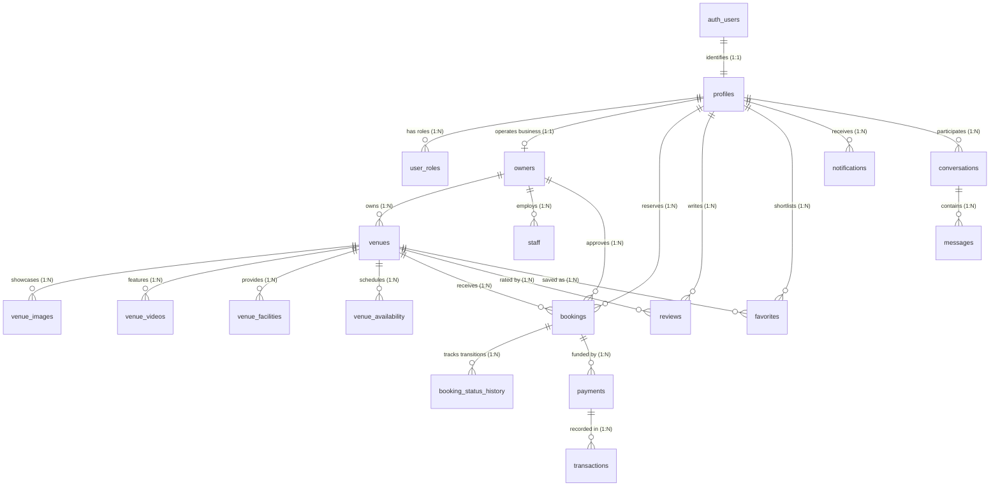

# Hall Khoj Finder — Database Relationships & Entity Relationship Diagram

## Key Relational Invariants:
1. Every booking is tied to exactly one `venue_id` and one `owner_id`.
2. Double-booking is prevented by unique compound constraint on `venue_availability(venue_id, event_date, time_slot)` with transactional locking.
3. Every payment links to a valid booking, with payment status segregated from booking status.
