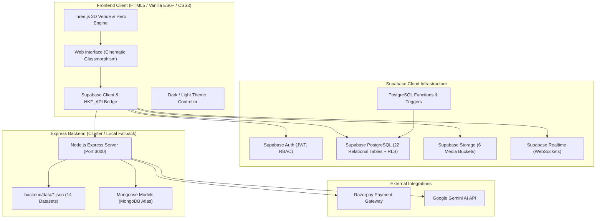

# Hall Khoj Finder — Existing Architecture
**Document Version:** 1.0.0  
**Target Environment:** Supabase Cloud + Vanilla JS / Three.js Frontend + Express Fallback

---

## 1. System High-Level Topology

---

## 2. Data Flow & Storage Tiers

1. **Client Tier**:
   - Runs directly in browser without framework dependencies.
   - Communicates with Supabase directly for authentication, queries, realtime subscriptions, and media uploads using the Supabase JavaScript Client.
   - Express server acts as an alternate microservice / migration runner / Razorpay webhook verifier.

2. **Persistence Tier**:
   - Primary: Supabase PostgreSQL relational database with Row Level Security (RLS) policies.
   - Migration Source: `backend/data/*.json` containing verified production records for 152 users, 41 venues, 61 owners, 63 bookings, and 19 categories.
   - Storage Buckets: Supabase Storage for high-resolution images, walkthrough videos, invoices, and KYC documents.

3. **Booking State Machine (Crucial Business Rule)**:
   - Status Progression:
     `REQUESTED` / `PENDING_OWNER_APPROVAL` -> `APPROVED` (by Owner) or `REJECTED` (by Owner) -> `PENDING_PAYMENT` -> `CONFIRMED` -> `COMPLETED`.
   - Double-booking prevention enforced via SQL transactions and status checks.
