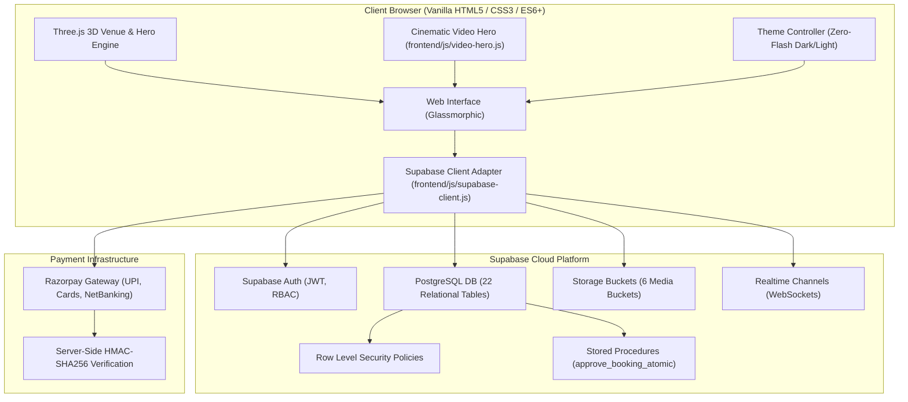

# Hall Khoj Finder — System Architecture
**Version:** 2.0.0 (Modernized Supabase Architecture)

---

## 1. High-Level Architecture Diagram

## 2. Component Boundaries
1. **Frontend Presentation**: Pure HTML5, CSS3 variables with glassmorphism blur filters, and Vanilla ES6+ modules without bulky frontend frameworks (React/Next).
2. **Data & Security Layer**: Supabase PostgreSQL handles data integrity, foreign key relations, unique constraints, and Row Level Security.
3. **Storage Tier**: Supabase Storage enforces bucket-level MIME restrictions (images, videos, PDF passes) and user-scoped file paths.
4. **Resilient Local Bridge**: When cloud keys are absent during local offline testing, `supabase-client.js` and `api.js` automatically bridge requests to the Express server and local verified JSON records.
